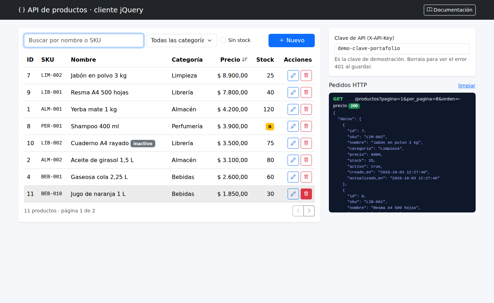
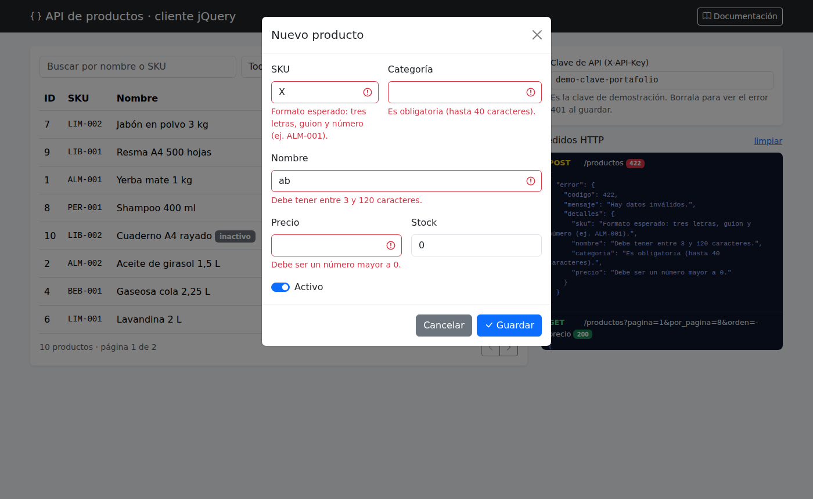

# API REST de productos

[English version](README.en.md)

API REST en **PHP sin frameworks** (compatible con PHP 5.6 a 8.x) sobre **MySQL**, con un **cliente en jQuery + Ajax + Bootstrap** que la consume y muestra cada pedido HTTP con su respuesta.



## Endpoints
| Método | Ruta | Descripción | Respuestas |
|---|---|---|---|
| GET | `/api/productos` | Lista con filtros, orden y paginación | 200 |
| GET | `/api/productos/{id}` | Un producto | 200, 400, 404 |
| POST | `/api/productos` | Crea un producto | 201 + `Location`, 400, 401, 409, 415, 422 |
| PUT | `/api/productos/{id}` | Reemplaza un producto | 200, 401, 404, 409, 422 |
| DELETE | `/api/productos/{id}` | Elimina un producto | 204, 401, 404 |
| GET | `/api/categorias` | Categorías con cantidad de productos | 200 |

**Parámetros de la lista:** `q` (nombre o SKU), `categoria`, `activo` (`true`/`false`), `sin_stock=1`, `orden` (`nombre`, `precio`, `stock`, `id`; con `-` adelante es descendente), `pagina`, `por_pagina` (máx. 50).

**Escritura:** POST, PUT y DELETE requieren el encabezado `X-API-Key`. Si el hosting bloquea PUT o DELETE, se pueden mandar como POST con `X-HTTP-Method-Override: PUT`.

**Errores:** siempre con el mismo formato:
```json
{ "error": { "codigo": 422, "mensaje": "Hay datos inválidos.", "detalles": { "precio": "Debe ser un número mayor a 0." } } }
```

### Ejemplos con curl
```bash
curl "http://localhost:8000/api.php/productos?q=yerba&orden=-precio"

curl -X POST http://localhost:8000/api.php/productos \
  -H "Content-Type: application/json" -H "X-API-Key: demo-clave-portafolio" \
  -d '{"sku":"BEB-010","nombre":"Jugo de naranja 1 L","categoria":"Bebidas","precio":1850,"stock":30}'

curl -X DELETE http://localhost:8000/api.php/productos/11 -H "X-API-Key: demo-clave-portafolio"
```

## Cómo está hecho
- `api.php` es el único punto de entrada (front controller): lee la ruta de `PATH_INFO`, decide recurso y método, y devuelve el código HTTP correcto (incluye `405` con el encabezado `Allow`).
- Orientado a objetos y compatible con PHP 5: `ProductoRepositorio` (acceso a datos con PDO y consultas preparadas), `ProductoValidador` (validación y normalización) y `Respuesta` (salida JSON).
- El orden se arma con una **lista blanca** de columnas: lo que manda el cliente nunca se concatena en el SQL.
- La clave se compara con `hash_equals` para evitar ataques de tiempo.
- CORS habilitado para consumirla desde otro dominio.
- `.htaccess` reescribe `/api/productos/5` a `api.php/productos/5`.

## Pruebas automáticas
`tests/prueba_api.php` prueba la API de punta a punta (16 casos: listados, orden, 401, JSON roto, 422, 201 + Location, 409, PUT, búsqueda, 405, 204, 404 y 400), sin librerías externas:
```
$ php tests/prueba_api.php http://localhost:8000/api.php
  OK    GET lista responde 200
  ...
16 pruebas OK, 0 fallas
```

## Instalación
**Local (modo demo):** `php -S localhost:8000` y abrir `http://localhost:8000/cliente/`. Crea `data/demo.sqlite` con 10 productos.

**Servidor con MySQL:** ejecutar `sql/schema.sql`, completar `includes/config.php` (y cambiar `API_KEY`) y subir los archivos.

## Capturas
| Validación en el cliente |
|---|
|  |
